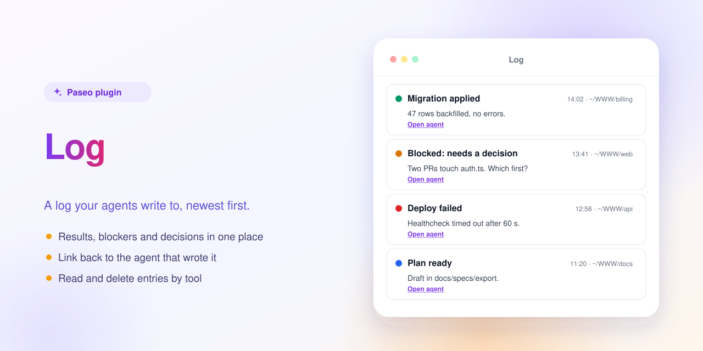

<p align="center"></p>

# Log — a Paseo plugin



A log that agents write to and you read, newest first.

Adds a **Log** item to the sidebar. Every agent created after install gets three tools: `log` (title, message, level: info, success, warning, error), `read_log` (latest entries with ids) and `delete_log` (remove by id, no undo). The sidebar item shows an unread count. Tell an agent to "log it" to leave a result, blocker or decision for later. Each entry shows the time, the agent's working folder and a link back to the agent; the screen refreshes every few seconds.

Entries are stored in `~/.paseo-log/log.jsonl` of the OS user running the daemon, so each daemon has its own log. Agents created before install don't have the tool until recreated.

## Install

Requires Paseo 0.11.4 or later.

```bash
paseo plugin install https://github.com/puchkoff/paseo-log
```

Or from a local clone: `paseo plugin install ./paseo-log`. Check with `paseo plugin ls`.

## Develop

```bash
npm install
npm run typecheck
npm test
```

The in-app description shown by Paseo lives in [OVERVIEW.md](OVERVIEW.md).
